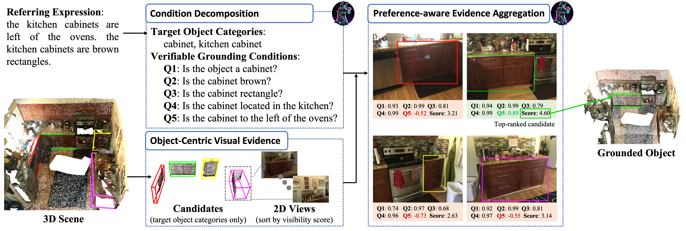
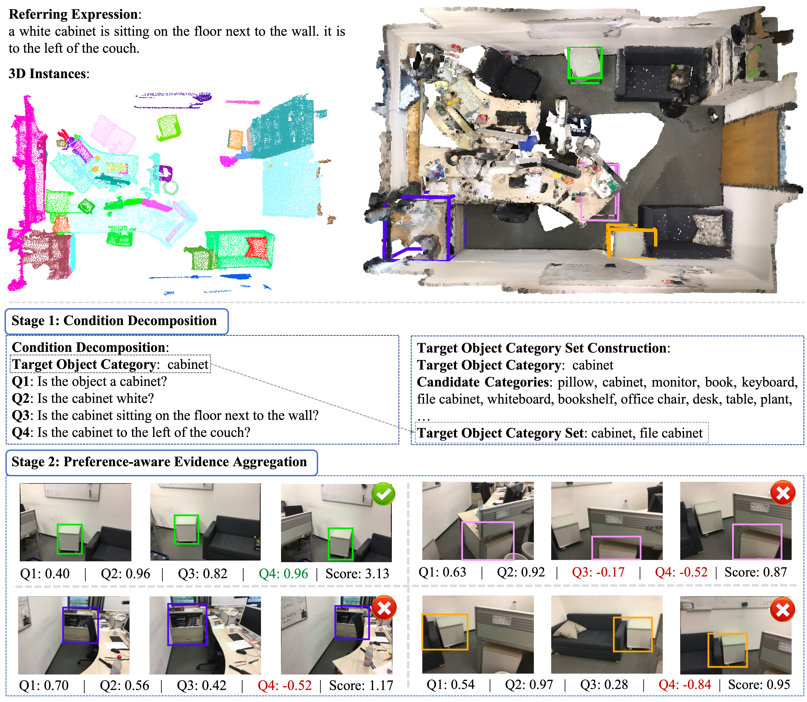

# QGround
This repository contains the official PyTorch implementation of the following paper:

Title: QGround: Condition-Wise Evidence Aggregation for 3D Grounding with 2D VLMs 

## Abstract
Using 2D vision-language models (VLMs) for 3D grounding raises a decision-formulation problem: how should image-level evidence be turned into a 3D object decision? This problem matters as pretrained 2D VLMs provide strong visual-semantic evidence, while 3D grounding requires disambiguating objects in cluttered scenes. Current VLM-based formulations make this conversion holistically: the model either selects one object from a rendered candidate set or assigns one overall match judgment to each candidate. Such decisions obscure the evidence needed for disambiguation, since different candidates may satisfy different subsets of the category, attribute, and relational cues. In this work, we reformulate 3D grounding with 2D VLMs as condition-wise evidence aggregation. The reformulation follows three principles: use natural object-centric images rather than rendered candidate images; read the referring expression condition by condition rather than as one holistic query; and use model preference rather than a hard match output as grounding evidence. We instantiate these principles in QGround, a training-free implementation of this decision formulation. Experiments on ScanRefer and Nr3D show improved grounding performance, with analyses demonstrating stronger candidate disambiguation and more interpretable decisions.

## Overall architecture

**QGround framework.**
QGround turns a referring expression into explicit grounding conditions, verifies each 3D candidate from object-centric natural views, and reads condition-level preferences from a 2D VLM. These preferences are aggregated into a fine-grained candidate ranking for the final grounding decision.


## Installation

### 1. **Clone this repository and navigate to the folder:**
```bash
git clone ***
cd QGround
```

### 2. **Install the inference package:**
```bash
# following the project llava
conda create -n qground python=3.10 -y
conda activate qground
pip install --upgrade pip
pip install -e ".[train]"
```

### 3. **Install the other package:**
```bash
pip install "flash-attn==2.5.7" --no-build-isolation --no-cache-dir
pip install easydict matplotlib 
```

## Data preparation

We follow the project of [M3DRef-CLIP](https://github.com/3dlg-hcvc/multi3drefer) for data preparation.


### ScanNet v2 dataset
Note: Both [ScanRefer](https://daveredrum.github.io/ScanRefer/) and [Nr3D](https://referit3d.github.io/) datasets requires the [ScanNet v2](http://www.scan-net.org/) dataset. Please preprocess it first.

1. Download the [ScanNet v2 dataset (train/val/test)](http://www.scan-net.org/) (refer to [ScanNet's instruction](dataset/scannetv2/README.md) for more details). And also render the scenes to get 2D views. The raw dataset files should be organized as follows:
    ```shell
    m3drefclip # project root
    ├── dataset
    │   ├── scannetv2
    │   │   ├── scans
    │   │   │   ├── [scene_id]
    │   │   │   │   ├── [scene_id]_vh_clean_2.ply
    │   │   │   │   ├── [scene_id]_vh_clean_2.0.010000.segs.json
    │   │   │   │   ├── [scene_id].aggregation.json
    │   │   │   │   ├── [scene_id].txt
    │   │   ├── frame_square
    │   │   │   ├── [scene_id]
    │   │   │   │   ├── color
    │   │   │   │   ├── depth
    │   │   │   │   ├── depth_inpainted
    │   │   │   │   ├── intrinsic
    │   │   │   │   ├── pose
    ```

2. Pre-process the data, it converts original meshes and annotations to `.pth` data:
    ```shell
    python llava/dataset/preprocess_all_data.py
    ```
   
### ScanRefer dataset
1. Download the [ScanRefer dataset (train/val)](https://daveredrum.github.io/ScanRefer/). Also, download the [test set](http://kaldir.vc.in.tum.de/scanrefer_benchmark_data.zip). The raw dataset files should be organized as follows:
    ```shell
    m3drefclip # project root
    ├── dataset
    │   ├── scanrefer
    │   │   ├── ScanRefer_filtered_train.json
    │   │   ├── ScanRefer_filtered_val.json
    │   │   ├── ScanRefer_filtered_test.json
    ```

2. Pre-process the data, "unique/multiple" labels and "3D bbox" will be added to raw `.json` files for evaluation purpose:
    ```shell
    python llava/dataset/scanrefer_preprocess.py
    ```

### Nr3D dataset
1. Download the [Nr3D dataset (train/test)](https://referit3d.github.io/benchmarks.html). The raw dataset files should be organized as follows:
    ```shell
    m3drefclip # project root
    ├── dataset
    │   ├── nr3d
    │   │   ├── nr3d_train.csv
    │   │   ├── nr3d_test.csv
    ```

2. Pre-process the data, "easy/hard/view-dep/view-indep" labels and "3D bbox" will be added to raw `.csv` files for evaluation purpose:
    ```shell
    python llava/dataset/nr3d_preprocess.py
    ```

### **LLAVA-OV model**:
Download the **LLAVA-OV** pretrained model to `/path/to/model/`
```bash
apt-get install git-lfs
git lfs install
git clone https://huggingface.co/lmms-lab/llava-onevision-qwen2-7b-ov.git
```

### **Instance Candidates**:

1. **ScanRefer candidates (Mask3D predictions)**  
   We use Mask3D-predicted instances as candidates (Follow the setting in ZSVG3D and use the [link]((https://cuhko365-my.sharepoint.com/personal/221019046_link_cuhk_edu_cn/_layouts/15/onedrive.aspx?id=%2Fpersonal%2F221019046%5Flink%5Fcuhk%5Fedu%5Fcn%2FDocuments%2FShare%2FZSVG3D%2Fmask3d%5Fpred%2Etar%2Egz&parent=%2Fpersonal%2F221019046%5Flink%5Fcuhk%5Fedu%5Fcn%2FDocuments%2FShare%2FZSVG3D&ga=1)) provided by them).  
   Download the predictions and specify the directory via `mask3d_pred_path` in `base.yaml`.  
   Then generate the candidate bounding boxes:

```bash
python llava/dataset/mask3d_candidates.py
```

2. We use the ground-truth instances as candidates. （Nr3D)
Run the following script to preprocess and extract candidate boxes:

```bash
python llava/dataset/GT_candidates.py
```

## Inference

### **step 1. parse description**:
```bash
python llava/qground/parse_description.py --dataset-type "scanrefer" (or "nr3d")
```

### **step 2. construct the target object category set**:
```bash
python llava/qground/construct_target_category.py --dataset "scanrefer" (or "nr3d")
```

### **step 3. candidate verification**:
```bash
python llava/qground/instances_verification.py --dataset "scanrefer" (or "nr3d")
```

### **step 4 (optional). evaluate**:
```bash
python llava/qground/evaluate_scanrefer.py  # for scanrefer dataset
python llava/qground/evaluate_nr3d.py   # for nr3d dataset
```

### Dataset-level files (shared by both models)

| Resource             | ScanRefer | Nr3D |
|:---------------------|:---------:|:----:|
| preprocessed dataset | None (need approval from the dataset owner) | [Nr3D_test.csv]() |
| candidates           | [Mask3D_candidates]() | [GT_candidates]() |

### Per-model outputs

The four files below are produced by `llava/qground/{parse_description, construct_target_category, instances_verification}.py`, one set per (dataset × VLM size). 

| Output                          | ScanRefer · LLaVA-OV-7B | ScanRefer · Qwen2-VL-72B | ScanRefer · LLaVA-OV-72B | Nr3D · LLaVA-OV-7B | Nr3D · LLaVA-OV-72B |
|:--------------------------------|:------------:|:-------------:|:-------------:|:-------:|:--------:|
| description parsing             | [link](https://drive.google.com/file/d/19wtZtU_ZvzPoN-gQXVSa2h_rG4NcvoCO/view?usp=sharing)     | [link](https://drive.google.com/file/d/1Aq0z823A6sH-r0fkq4IyvBQ-2Q_tmwpI/view?usp=sharing) | [link](https://drive.google.com/file/d/1NczHhjup8ARBzPKhosE8rb_vUUkyqFDb/view?usp=sharing)      | [link](https://drive.google.com/file/d/1c6iPJxyo8JDHqQkYqDfHGrT4Ao5fLFDz/view?usp=sharing)| [link](https://drive.google.com/file/d/1CwZFCGB28EZB3xPIwQ1TjhWpVlQDJEH0/view?usp=sharing) |
| target category set             | [link](https://drive.google.com/file/d/1LmsgmPyc7_dyCdDwziO0ozNLM5gCu6E6/view?usp=sharing)     | [link](https://drive.google.com/file/d/1u3KJaJKFdL7l4UqinvK9s4oSJlIUfeEd/view?usp=sharing) | [link](https://drive.google.com/file/d/1UhInBbQVnDRtUNaOWU3t4dMDAYeaEzcO/view?usp=sharing)      | [link](https://drive.google.com/file/d/1ClpGMpg-G90eyOE3Pi8IiNLCUdXb9t78/view?usp=sharing)| [link](https://drive.google.com/file/d/1Zv0G5e6aR5XWxZwbO9DTe2tglI3g-8AX/view?usp=sharing) |
| instance verification (details) | [link](https://drive.google.com/file/d/1HaWteu2EZSypsZGWNECBgB9g_ZNdNc86/view?usp=sharing)     | [link](https://drive.google.com/file/d/1qEGmDV4poCOHv6rBG3CuwOB-KPGzGABx/view?usp=sharing) | [link](https://drive.google.com/file/d/1tIsivvklNwXHWhcNrFKWLVyxv3T-bnwx/view?usp=sharing)      | [link](https://drive.google.com/file/d/171r93yut8G8HcCxEAENvdAwTnjS71znA/view?usp=sharing)| [link](https://drive.google.com/file/d/12lLTf_6HsGwsY1G-h61sfnSrdGNC9rxF/view?usp=sharing) |
| prediction (`.pkl`)             | [link](https://drive.google.com/file/d/1W8UhyFxQcTf6B2tlHAm4O3X5W_lMtHZ1/view?usp=sharing)     | [link](https://drive.google.com/file/d/1dUZATTIESgQnBs11IjS_l8CPyaeZHJNb/view?usp=sharing) | [link](https://drive.google.com/file/d/1jt_t-KBbiJQEj-L71wAGqbGOSBPKgFUf/view?usp=sharing)      | [link](https://drive.google.com/file/d/1EJPmgBVsAvkH8IGpnw7UNbOmMujdN2Tv/view?usp=sharing)| [link](https://drive.google.com/file/d/1MSgQITuDsr2k_cIFFcWarhuVhsE1-Hl8/view?usp=sharing) |


## A Full Demo of QGround

**A full demo of QGround**. **Top**: Input referring expression, 3D scene, and Mask3D~\cite{schult2022mask3d} instance proposals. **Bottom**: QGround first decomposes the expression into a target category $c$ and verifiable grounding conditions $\mathcal{Q}$, then expands $c$ into a category set $\mathcal{C}$ for open-vocabulary candidate filtering. Retained candidates are evaluated from object-centric views with preference-aware condition verification, and the final object is selected by aggregating condition-level support and rejection.

## Related Projects

- This code is based on [LLaVA-NeXT](https://github.com/LLaVA-VL/LLaVA-NeXT)
- [M3DRef-CLIP](https://github.com/3dlg-hcvc/M3DRef-CLIP)
